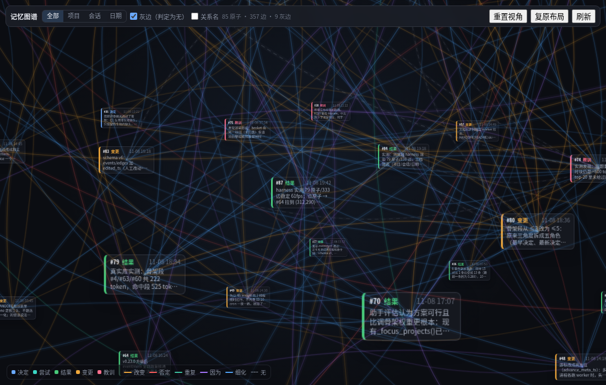
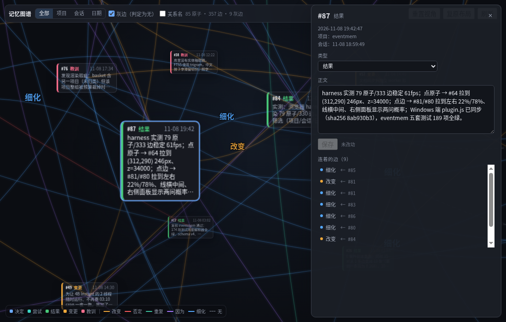

# eventmem

[](https://github.com/wackyju2-beep/hermes-eventmem/actions/workflows/tests.yml)
[](LICENSE)

**English** · [中文](README.zh-CN.md)

**Memory that remembers what changed.** Most memory layers for agents remember what was said: split the
transcript, embed the chunks, fetch top-k. eventmem remembers which fact replaced which, on what date, and how
sure the judge was.

One SQLite file, no API key, no GPU: append-only events, five typed directed relations, and a 4B judge running
on the CPU.

<sub>v0.2.1 · schema v7 · 237 checks</sub>

I wrote it for my own agent, on a mini PC with no graphics card. The problem was concrete: chunk memory kept
handing me paragraphs where half the sentences had already been replaced by something newer, and nothing in the
store said which half. The model had to guess; when it guessed wrong it quoted a three-month-old number as
current. So I made the replacement itself data — an edge with a direction, a type, a probability and a date.


*My store at the time of the screenshot: 85 events, 357 edges. Boxes are events, curves are corrections, faint
dashed lines are pairs the judge considered and rejected.*

## Four claims

1. **Memory as change.** A correction is stored, not re-derived at recall time.
2. **Explicit, traceable relations.** Five typed directed edges, inspectable and editable.
3. **Local, CPU-powered.** A 4B judge decides relations; 6.7 s per pair, no generative API on this path.
4. **Core + adapters.** The engine does not know Hermes exists.

The rest of this file is the evidence.

## 1. Memory as change

An event is a timestamp, a kind, and one sentence. Five kinds: `decision / attempt / result / change / lesson`.
Events are append-only: history is never edited, a correction is appended to it. Kind and relation names are
stored and accepted in Chinese (`决定 / 尝试 / 结果 / 变更 / 教训`); the English words in this file are reading
labels.

```
[11-05] decision  the mini PC uses a 256G SSD as its system disk
[11-06] change    the mini PC switched to a 2T NVMe system disk   -> changes the line above
```

Recall that hits the old event follows the edge and renders it as `[superseded by 11-06]`. The model is told
that the 256G number is stale instead of having to notice it.

| | chunk memory | eventmem |
|---|---|---|
| stores | text + vectors | timestamped events + corrections |
| a fact changes | the old chunk stays, a new one is added | a Change event points at the old one |
| recall returns | top-k paragraphs, some already stale | the current state + the path that produced it |
| "why did this change?" | nowhere | on the edge (because / refine) |

The last row is the point: staleness is decided **when the fact changes**, not guessed at read time.

Commands, configs, logs and code go into artifacts, stored once by content hash and referenced from the event,
so the event sentence stays one line.

## 2. Explicit, traceable relations

Five directed relations, always old → new:

| relation | meaning |
|---|---|
| **change** (改变) | the later event replaces a parameter, object, config or condition |
| **negate** (否定) | the later event overrules or retires the earlier one, with no substitute of the same kind |
| **repeat** (重复) | same meaning in different words, nothing substantive added |
| **because** (因为) | the later event explains why the earlier one happened or was chosen |
| **refine** (细化) | the later event adds execution detail: steps, local parameters |

The change/negate boundary is "did it give a substitute parameter of the same kind?", not "does it sound
negative". That distinction is a design decision, not a model side effect.

These edges are data, not inference. A relation is judged once, written to SQLite with its direction, type,
timestamp and the judge's raw distribution, and then read for free. Recall does not call a model to work out
whether two sentences contradict each other.

What gets stored is the judgment, not just the conclusion:

- `edges.probs` keeps the full distribution behind each edge — four options on the axis question, three on the
  detail question.
- `pair_evals` keeps pairs that were judged and **rejected**, so the graph can draw them as faint dashed lines.
- An edge is written only when the top answer is a real label **and** leads the runner-up by `margin = 0.15`.
  Change the margin later and it is one SQL query over the stored distributions — no second night of inference.

The candidate set stays bounded. A new event is only compared against *active heads*: events that nothing has
changed, negated or repeated yet. Four sources feed the list: vector top-10, recent heads from the same session,
events sharing an artifact or a file path, and cross-project pairs when both ends are changes or decisions.
On my corpus, 42 events produce 113 pairs; the previous "everything within seven days" rule produced about 861
on the same corpus, and the gap grows with the library.

You can inspect all of it. `mem_neighbors 62` returns what #62 replaced, what replaced it, and the events around
it in the same session. In the desktop app the whole store is a 3D graph; the inspector shows the distribution
behind each line, and a relation judged wrong can be edited by hand. Edited items get a rainbow rim.


*One edge: refine at 0.706, with the other question's distribution underneath and a control to override it.*

## 3. Local, CPU-powered

The judge is a small decision model, used as a classifier. One forward pass answers two independent questions
about a pair: what did the later event do to the earlier one (repeat / change / negate / neither), and does it
also explain it (because / refine / neither). We read the softmax distribution; no prose is generated.

Measured on the machine this was built for — a 6-core mini PC, no GPU:

- llama.cpp serving StartLux 4B Instant, Q8_0, 4.48 GB
- **6.7 s per pair** on 6 threads; 16–18 s on 2 threads
- prefill ≈ 82 tok/s; cost is linear in prompt tokens, with no hidden fixed overhead

Two questions in one pass is deliberate. A single six-way question was measured at 2.85 s, but it produced one
label and the softmax collapsed genuinely different relations (negate 0.579 → 0.216). Two narrower questions
cost more per pair and can produce two edges.

To be precise about "no API": this applies to the **relation** path. End-of-turn extraction still uses the
host's auxiliary model (Hermes calls it `call_llm`), which can be local or remote. The store never leaves the
machine, and the only HTTP call the core makes is to your own judge endpoint (`EVENTMEM_JEV_URL`, default
`http://127.0.0.1:18090`).

Everything is optional:

- No judge → events and recall still work, you just get no edges.
- No onnxruntime → the vector arm disappears silently and recall is FTS5-only.
- The whole store is one SQLite file; one background process wakes up when there are new events.

And the honest limit: the Instant model is weaker than its thinking sibling on pair judgement (DecisionPivot
41.5 vs 59.9), which is why the margin and the prompt definitions matter more than swapping the model.

## 4. Core + adapters

The rule for the boundary is one question: *if I change the host, does this code still hold?* If yes, it is core.

```
core/eventmem_core/          schema · store · recall · embed · edges · worker · i18n
adapters/hermes/             everything that knows about Hermes
  eventmem/                  memory provider: tools, middleware, end-of-turn extraction, settings
  eventmem-graph/            dashboard backend for the 3D graph
  desktop-plugins/           graph UI: one plugin.js, the host injects React
```

Core has no `import agent.*` (a test enforces it), does not know `~/.hermes`, tool names, middleware or
`config.yaml`. The adapter is translation only: a tool call becomes one `EventMem` method call, a host config
becomes a `CoreSettings`, a host model call becomes one extraction request. It writes no SQL and does no recall
fusion.

```python
from eventmem_core import EventMem, CoreSettings, apply

settings = apply(CoreSettings(db_path="/path/events.db"), {"edges": {"margin": 0.2}})
mem = EventMem(settings)
mem.add_event("结果", "……", project="mini-pc", session="s1")
mem.recall("which disk did we pick?", state=mem.new_recall_state())
```

Hermes is the first adapter; DeepSeek Harness is the next one. The things a new host should not have to rewrite
are exactly the things in core: the margin, active heads, RRF, the skeleton, the rendering budget.

The graph backend is the one deliberate exception to "adapters go through `EventMem`": it reads the same SQLite
file directly. It needs the whole event table (the provider's recall queries are all top-k), and its two manual
edits are plain UPDATEs. That keeps FastAPI out of the memory plugin, and the graph never registers a provider.

## A turn, end to end

**Write.** A tool middleware appends one reminder line to state-changing tool results, so the model writes its
event in the same turn, while the reason is still fresh. If the turn wrote nothing, `sync_turn` asks an
auxiliary model for 0–3 events from the exchange; small talk is filtered before the call.

**Read.** A skeleton pass gives each project's shape once per session (oldest decision, newest decision, newest
result, newest change, newest lesson). The hits pass runs vector + FTS5 with RRF, adds one hop along correction
edges, and adds same-session neighbours. Anything already shown this session collapses into one pointer line.

**Edges.** A resident worker checks the cursor every 60 s. When there are new events it builds candidates, asks
the judge two questions per pair, writes edges that pass the margin, and advances the cursor only on success.

## Install

```bash
git clone https://github.com/wackyju2-beep/hermes-eventmem ~/eventmem
cd ~/eventmem && ./install.sh
```

`install.sh` symlinks the three Hermes-side directories into `~/.hermes`:

```
adapters/hermes/eventmem                          -> ~/.hermes/plugins/eventmem
adapters/hermes/eventmem-graph                    -> ~/.hermes/plugins/eventmem-graph          (optional)
adapters/hermes/desktop-plugins/eventmem-graph   -> ~/.hermes/desktop-plugins/eventmem-graph (optional)
```

Then switch it on:

```yaml
memory:
  provider: 'eventmem'
plugins:
  entries:
    eventmem:
      settings: {}               # optional; core defaults apply
```

```bash
hermes plugins enable eventmem-graph   # only for the graph
```

It takes effect in a new session. The database is created on first write at `~/.hermes/eventmem/events.db`
(schema v7). All thresholds live under `plugins.entries.eventmem.settings`; defaults and meanings are in
[`docs/settings.md`](docs/settings.md).

Vector arm (optional): `pip install onnxruntime tokenizers numpy`, then drop a Qwen3-Embedding-0.6B ONNX
(512-dim, int8) into `~/localmem/models/`. Missing anything just means FTS-only, silently.

## Using it

The model calls these; you normally don't.

| tool | what it does |
|---|---|
| `evt_add` | write 1–n events |
| `mem_recall` | semantic + literal search |
| `mem_neighbors` | what #N replaced / what replaced it / same-session neighbours |
| `expand` | the full artifact behind an event |
| `proj_add` / `proj_list` | projects (human-named, closed vocabulary) |
| `evt_forget` | delete one event |

Every turn the model also gets one line with the existing projects ranked by relevance to the turn, so it knows
what to reuse before it invents a new name.

The graph lives in the desktop app: the `记忆图谱` chip in the status bar, or the `/eventmem-graph` route.

| action | result |
|---|---|
| left-drag empty space / wheel | orbit / zoom |
| middle-drag | pan |
| click a box | camera flies to it, box pulled forward; edit kind and text on the right |
| click an edge | endpoints pulled to the left and right of the screen; distribution, edit, delete |
| left-drag a box | put it anywhere; positions survive a refresh |
| click empty space | drops focus only, nothing snaps back |
| filter | non-matching atoms recede; either the matches, or the matches plus one-hop neighbours |


*One atom: text, kind, project, and the nine edges attached to it.*

## Tests

Plain scripts, no pytest:

```bash
cd ~/eventmem
for t in store recall nightly worker i18n plugin settings hermes_settings; do
  python3 tests/test_$t.py | tail -1
done
```

```
store            PASS 31
recall           PASS 33
nightly          PASS 93
worker           PASS 3
i18n             PASS 10
plugin           PASS 43
settings         PASS 14
hermes_settings  PASS 10
```

237 checks. Each case gets its own temporary database, and nothing touches `~/.hermes`. Recall tests use a
`FakeEncoder`, so they pass without numpy or onnxruntime. `test_plugin.py` needs the host's
`agent.memory_provider`; on a bare machine (CI) `tests/_host_stub.py` substitutes a minimal stub, which is why
the suite is green on 3.11 and 3.12 in Actions too.

## Known limitations

- No migration. Chunks in another memory store do not become events; accumulation starts when you switch it on.
- The model picks the project. Tools reject unknown names, but a wrong-but-real project is not caught. Fix it by
  eye in the graph.
- Relation quality is the judge's quality. The 4B Instant model is weaker than its thinking sibling on pair
  judgement (41.5 vs 59.9); thresholds and prompt wording matter more than the model choice.
- The thresholds (vector 0.35, margin 0.15, budgets 600/850) were set on a small corpus. Re-measure at a few
  thousand events.
- The graph UI and the stored kind/relation names are Chinese. Model-facing text is bilingual.
- This is a personal project, not a product: no hosted service, no support, and no promise that the schema
  stays put between versions.

## License

MIT. See [`LICENSE`](LICENSE). Third-party weights are not distributed here; the decision model I measured is
CC BY-NC 4.0.
