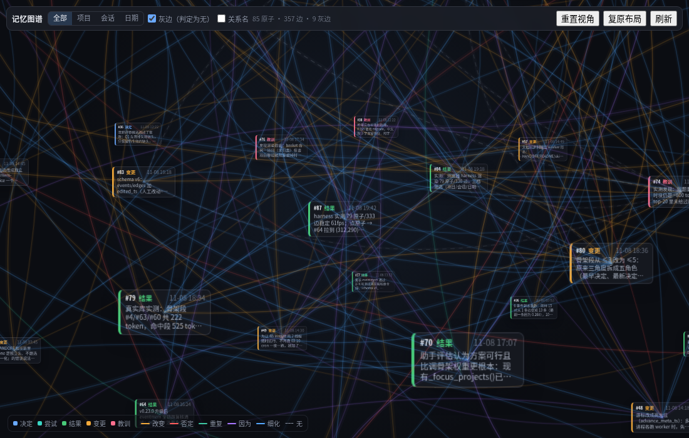
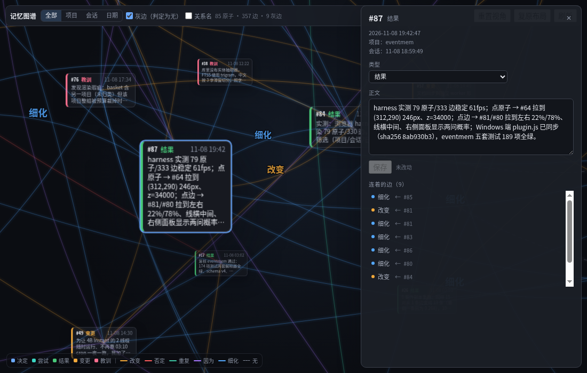

# eventmem

[](https://github.com/wackyju2-beep/hermes-eventmem/actions/workflows/tests.yml)
[](LICENSE)

[English](README.md) · **中文**

**记住「变化」本身的记忆层。** 大多数 agent 记忆层记住的是「说过什么」：把对话切块、向量化、取 top-k。
eventmem 记住的是哪条事实取代了哪条、哪天、多大把握。

一个 SQLite 文件，不需要 API key，不需要 GPU：事件只追加，五种有向关系，判定模型跑在 CPU 上。

<sub>v0.3.0 · schema v8 · 343 项检查</sub>

这套东西是给我自己的 agent 写的，机器是一台没有显卡的小主机。起因很具体：切块记忆每次递过来一整段话，
里面总有一半句子已经被更新的东西替代了，而库里没有任何字段告诉我哪一半。模型只能猜；猜错就把三个月前的
旧参数当成现在的。所以我把「取代」这件事本身写成数据：一条有方向、有类型、有概率、有日期的边。


*截图时我的库：85 条事件、357 条边。方框是事件，曲线是修正关系，灰色虚线是判过但没连上的对。*

## 四句话

1. **记忆即变化**——修正在写入时存下来，不在召回时重新推断。
2. **关系是显式的**——五种有向边，能查、能审、能改。
3. **判在 CPU 上**——4B 判别模型，一对 6.7 秒，这条路径不调生成式 API。
4. **core + adapter**——引擎不知道 Hermes 存在。

下面每一条都给依据。

## 一、记忆的单位是变化

一条事件 = 时间戳 + 类型 + 一句话。类型只有五种：`决定 / 尝试 / 结果 / 变更 / 教训`。
事件只追加：历史不改，改的方式是再写一条修正。

```
[11-05] 决定  小主机用 256G SSD 做系统盘
[11-06] 变更  小主机换 2T NVMe 做系统盘      -> 改变上面那条
```

召回命中旧事件时，会顺着边找到新的那条，把旧的渲染成 `[已失效·被11-06取代]`。
模型不需要自己发现 256G 这个数过时了，它被告知了。

| | 切块记忆 | eventmem |
|---|---|---|
| 存什么 | 文本 + 向量 | 带时间的事件 + 修正关系 |
| 事实变了 | 旧块还在，新块再加一块 | 一条「变更」事件指向旧的那条 |
| 召回给什么 | top-k 段落，其中一部分已经过时 | 现在的状态 + 它是怎么变成这样的 |
| 「为什么变」 | 无处可查 | 在边上（因为 / 细化） |

最后一行才是重点：**失效是在事实变化时确定的，不是在读取时猜的。**

命令、配置、日志、代码放进 artifact，按内容哈希只存一份，事件里留引用，所以事件正文永远是一行。

## 二、关系是写下来的边，不是召回时猜的

五种关系，方向永远是旧 → 新：

| 关系 | 含义 |
|---|---|
| **改变** | 后一条替换了前一条的参数、对象、配置或条件 |
| **否定** | 后一条推翻或废止前一条，且没有给出同类平替 |
| **重复** | 语义等价，换了个说法，没有实质性新增 |
| **因为** | 后一条解释了前一条为什么发生 / 为什么这样选 |
| **细化** | 后一条补执行细节：步骤、局部参数 |

`改变` 和 `否定` 的边界是「有没有给出同类平替参数」，不是「听起来像不像否定」。
这是设计时定下的判据，不是模型随机分的。

这些边是数据，不是推断。一条关系只判一次，连同方向、类型、时间和模型的原始分布一起写进 SQLite，
之后读取是免费的。召回不会为了判断两句话是否矛盾再去调一次模型。

存下来的是判定，不只是一个结论：

- `edges.probs` 保留每条边背后的完整分布（第一问 4 个选项，第二问 3 个）。
- `pair_evals` 连**判过但没连边**的对也留着，所以图谱能把它们画成灰色虚线。
- 只有第一名是真实标签、且比第二名高出 `margin = 0.15` 才写边。以后想调阈值，是对着库里的分布
  算一条 SQL，不用再跑一晚推理。

候选集是常数级的。新事件只和**活跃链头**比：还没被改变、否定、重复过的事件。候选来自四路：
向量 top-10、同会话最近的链头、共享同一个 artifact 或同一个文件路径的、以及两端都是变更/决定时的
跨项目对。我的语料里，42 条事件产生 113 对；旧的「同项目七天全组合」规则同规模约 861 对，
而且库越大差得越多。

这些都能当场翻开。`mem_neighbors 62` 会告诉你 #62 取代了谁、谁改了它、同会话前后还有哪些。
桌面版把整库画成 3D 图，检查器里能看每条线背后的概率分布；判错的关系可以直接改，改过的描一圈彩虹边。


*点开一条边：细化 0.706，下面另一问的分布也在，旁边可以直接改判。*

## 三、判关系的是 CPU 上的小模型

判关系用的是一个小型决策模型，当分类器用。一对事件一次前向，同时回答两个独立的问题：
后一条对前一条做了什么（重复 / 改变 / 否定 / 都不是），以及它是否解释了原因（因为 / 细化 / 都不是）。
读的是 softmax 分布，不生成任何文字。

数字是在开发它的那台机器上测的——6 核小主机，没有显卡：

- llama.cpp 加载 StartLux 4B Instant，Q8_0，4.48 GB
- **6 线程 6.7 秒一对**；2 线程 16–18 秒
- prefill ≈ 82 tok/s；耗时与 prompt token 数线性，没有隐藏的固定开销

两个问题一次前向是故意的。单一 6 选 1 实测 2.85 秒，但只产出一个标签，softmax 会把真实存在的关系
压掉（否定 0.579 → 0.216）。两问版每对更贵，但能给出两条边。

「不调 API」要说准确：指的是**关系判定**这条路。回合末抽取仍然用宿主的 auxiliary 模型
（Hermes 里是 `call_llm`），那个可以是本地也可以是远端。库不会离开这台机器；core 唯一会发起的
HTTP 请求是连你自己的判定服务（`EVENTMEM_JEV_URL`，缺省 `http://127.0.0.1:18090`）。

所有部件都可选：

- 没有判定模型 → 事件和召回照常，只是没有边。
- 没有 onnxruntime → 向量臂静默消失，召回退化成纯 FTS5。
- 整库一个 SQLite 文件；只有一个后台进程，有事件时才醒。

也得说清楚短板：Instant 版在成对判别上弱于思考版（DecisionPivot 41.5 对 59.9），
所以 margin 和提示词定义比换模型更值得花时间。

## 四、core 不认识宿主，adapter 只做翻译

边界的判据只有一个问题：**换一个宿主，这段代码还成立吗？** 成立就在 core。

```
core/eventmem_core/          schema · store · recall · embed · 连边 · packs · decision
                             runtime · daemon · install · worker · ui · i18n
adapters/hermes/             所有知道 Hermes 存在的东西
  eventmem/                  记忆 provider：工具面、中间件、回合末抽取、配置
  eventmem-graph/            图谱后端（dashboard 插件）
  desktop-plugins/           图谱前端：一个 plugin.js，宿主注入 React
```

core 里没有 `import agent.*`（有测试盯着），不知道 `~/.hermes`、工具名、中间件和 `config.yaml`。
adapter 只做翻译：一次工具调用翻成一个 `EventMem` 方法，一份宿主配置翻成 `CoreSettings`，
一次宿主模型调用翻成一次抽取请求。它不写 SQL，也不做召回融合。

```python
from eventmem_core import EventMem, CoreSettings, apply

settings = apply(CoreSettings(db_path="/path/events.db"), {"edges": {"margin": 0.2}})
mem = EventMem(settings)
mem.add_event("结果", "……", project="小主机", session="s1")
mem.recall("上次那个盘怎么选的？", state=mem.new_recall_state())
```

Hermes 是第一个 adapter，DeepSeek Harness 是下一站。换宿主时不该重写的东西，恰好就是 core 里的那些：
margin、活跃链头、RRF、骨架、渲染预算。

两个宿主共用一个库也分得清谁写的：`EventMem(settings, agent="hermes")` 把这个实例的标签写进
`events.agent`，adapter 再把自己的会话 id 加上宿主前缀（`hermes:20261111_…`）。没有 `agent` 的行就是
早于这一列的老事件——不猜、不回填。

默认部署形态是**一台机器**：一个 `events.db`、一个 daemon、任意多个宿主进程通过 WAL 读写。
同机的两个 agent 可以共用这个文件，只要**每个库只有一个 daemon**（第二个会直接拒绝启动：
`<db>.daemon.lock` 是 `flock`）。跨机器的宿主改用 daemon 的**数据面**（同一个 loopback 端口，
走 SSH 隧道）：`POST /api/mem/events`、`POST /api/mem/recall`、`GET /api/mem/projects`、
`GET /api/mem/events/<id>`……它是 `EventMem` 的薄镜像——只做校验和渲染，批量、批内链接、脱敏都归 adapter。
库文件永远不出这台机器；接口没有鉴权，所以只绑回环，这是设计而不是疏漏。规格见 [`docs/api.md`](docs/api.md)。

图谱后端是「adapter 一律走 `EventMem`」的唯一例外：它直接读同一张 SQLite 库。它要的是整张事件表
（provider 的召回查询全是 top-k），而它的人工编辑就是两条 UPDATE。这样 FastAPI 不进记忆插件，
图谱那边也永远不注册 provider。

## 一个回合实际怎么跑

**写**：工具中间件在每个「改变了状态」的工具结果末尾追加一行提醒，让模型在同一个回合里把事件写掉，
而不是等到对话末尾，那时候「为什么」已经凉了。整回合一条都没写，`sync_turn` 会在回合结束后再调一次
auxiliary 模型，从这轮问答里抽 0–3 条；寒暄在调模型之前就被挡住。

**读**：骨架段每会话每项目给一次（最早的决定、最新的决定、最新的结果、最新的变更、最新的教训）。
命中段做向量 + FTS5 的 RRF，沿修正边展开一跳，加上同会话邻居。本会话已经给过的条目只留一行指针。

**边**：常驻 worker 每 60 秒看一次游标。有新事件就挑候选、一对两问、按 margin 写边，
成功才推进游标。

## 安装

```bash
git clone https://github.com/wackyju2-beep/hermes-eventmem ~/eventmem
cd ~/eventmem && ./install.sh
```

`install.sh` 把三份 Hermes 侧目录软链进 `~/.hermes`：

```
adapters/hermes/eventmem                          -> ~/.hermes/plugins/eventmem
adapters/hermes/eventmem-graph                    -> ~/.hermes/plugins/eventmem-graph          （可选）
adapters/hermes/desktop-plugins/eventmem-graph   -> ~/.hermes/desktop-plugins/eventmem-graph （可选）
```

然后启用：

```yaml
memory:
  provider: 'eventmem'
plugins:
  entries:
    eventmem:
      settings: {}               # 可选；不写就是全部默认值
```

```bash
hermes plugins enable eventmem-graph   # 要图谱才需要
```

重启会话后生效。数据库建在 `~/.hermes/eventmem/events.db`，第一次写入时自动建表（schema v8）。
所有阈值都在 `plugins.entries.eventmem.settings` 下，默认值和含义见
[`docs/settings.md`](docs/settings.md)。

### 判关系的模型是一个文件夹（v0.3）

用哪个模型判关系，不再是插件里的一个设置项，而是一个目录：

```
~/.hermes/eventmem/backends/lev/config.yaml
```

三种形态，由文件里写了哪些键决定：`weights:`（eventmem 自己拉起 `llama-server`）、
`base_url:` + `external: true`（别人在跑：LM Studio、systemd、start.sh）、只写 `base_url:`
（云端）。**把文件夹放进去就是安装**。完整键表、回退规则、排错表见
[`docs/backends.md`](docs/backends.md)，能直接拷的样例在 [`examples/backends/`](examples/backends/)。

自托管路径一条命令——按本机硬件选 `llama.cpp` 包、下 GGUF、校验 sha256、写好 pack：

```bash
PY=~/.hermes/hermes-agent/.venv/bin/python
$PY ~/eventmem/adapters/hermes/run.py models install lev
```

然后配链路，写在 `~/.hermes/eventmem/settings.yaml`（GUI 和手写读写同一份）：

```yaml
decision:
  backends: [typesafe, lev]      # 谁先活着，谁负责整轮
```

没配 key 的 `typesafe` 不算错：探活返回 `needs_key`，链路自动走到 `lev`，每条边都记着是哪个后端
判的（`edges.backend`）。链路为空 = 只用 `decision.url` 那个单端点，也就是 v0.2 的行为。

`run.py daemon` 是这一切背后的常驻进程：轮询、只在有活时拉起自托管 pack，并在
**http://127.0.0.1:9123/** 提供一个 GUI（概览 / 后端 / 模型 / 调度 / 日志），它只是同一套 JSON
路由的薄客户端。

这个地址只在跑 daemon 的那台机器上存在——桌面端连的是**远端** backend 时就正好用不了。所以
adapter 里还带了一个 `eventmem-gui` dashboard 插件，把整个管理台原样挂到 dashboard 自己的源下
（`/api/plugins/eventmem-gui/`，走 dashboard 的登录鉴权）。在 app 里它是状态栏那颗 **记忆后台**
按钮；在浏览器里就是 dashboard 主机上的同一个路径，不用记隧道。daemon 在别的机器上时，用
`EVENTMEM_DAEMON_URL` 把代理指过去。

向量臂（可选）：`pip install onnxruntime tokenizers numpy`，再把 Qwen3-Embedding-0.6B 的 ONNX
（512 维 int8：`tokenizer.json` + `model_int8.onnx`）放进 `<hermes_home>/eventmem/models/`——
模型归 eventmem 自己所有，不要塞进别的插件目录。缺任何一个都只是静默降级到纯 FTS，
所以要主动查 `Encoder(...).available()` 或日志里的 `encoder ready`，别把安静当成没事。

## 用起来

模型自己调这些工具，人一般不用管。

| 工具 | 作用 |
|---|---|
| `evt_add` | 写 1–n 条事件 |
| `mem_recall` | 语义 + 字面混合检索 |
| `mem_neighbors` | #N 取代了谁 / 谁改了它 / 同会话邻居 |
| `expand` | 取某条事件背后的 artifact 原文 |
| `proj_add` / `proj_list` | 项目（人工命名，封闭词表） |
| `evt_forget` | 删除一条事件 |

模型每回合还会收到一行现有项目，按与本回合的相关度排序，所以它在选项目或新建项目之前先知道有什么。

图谱在桌面版：**记忆后台 → 图谱**页（`eventmem-graph` 插件本身不再有按钮和页面，它只把三维视图交给控制台）。

| 操作 | 效果 |
|---|---|
| 左键空白拖动 | 平移相机 |
| 中键拖动 | 转视角 |
| 右键按住再拖 | 框选：选中所见范围内、投影中心落在框里的原子 |
| 滚轮 | 沿视线前后移动（退得很远时小球收成彩色圆点，不带编号） |
| 点方框 | 相机飞过去，方框拉到眼前；右侧改类型、正文和项目 |
| 点边 | 两端拉到画面左右；右侧看分布、改关系、删边 |
| 左键拖方框 | 摆到任意位置，刷新还在 |
| 框选之后 | 批量面板：一次改项目和/或类型；已有的边一条不删，候选重新选，判过的对不会再问 |
| 点空白 | 只退出焦点，不回弹 |
| 筛选 | 项目 / 会话 / 日期 / 类型 / 边的关系 / 序号 / 语义检索，全部按 AND 叠加；可只看命中，或带上一跳邻居 |

语义检索用召回同一个编码器给输入编码，取相似度最高的 N 条，再与其余条件取交集。它依赖 `events.vec`
有向量、ONNX 运行时可用；两者缺一时图谱会明说，而不是安静地返回空。


*点开一个原子：正文、类型、项目，以及和它相连的 9 条边。*

## 测试

纯脚本，不需要 pytest：

```bash
cd ~/eventmem
for t in store recall nightly worker i18n plugin settings hermes_settings \
         packs decision daemon install ui gui_proxy; do
  python3 tests/test_$t.py | tail -1
done
```

```
store            PASS 32      packs            PASS 27
recall           PASS 33      decision         PASS 21
nightly          PASS 93      daemon           PASS 16
worker           PASS 3       install          PASS 19
i18n             PASS 10      ui               PASS 15
plugin           PASS 43      gui_proxy        PASS 7
settings         PASS 14      ──────────────────────────
hermes_settings  PASS 10      343
```

343 项检查，每个用例一个自己的临时库，不碰 `~/.hermes`。召回测试用 `FakeEncoder`，
没有 numpy / onnxruntime 也能全绿。`test_plugin.py` 需要宿主的 `agent.memory_provider`，
裸机器（CI）上由 `tests/_host_stub.py` 换成一个最小桩，所以 3.11 和 3.12 的 Actions 也是全绿。

v0.3 这几个套件故意做成端到端：`test_daemon` 真起子进程，`test_install` 用本地 HTTP 服务冒充
发布页和模型仓（含 `Range` 续传），`test_ui` 走真 HTTP 调 daemon——GUI 没有别的客户端，路由就是契约。

## 已知限制

- 不迁移旧数据。别的记忆库里的历史块不会变成事件，只能从启用之后开始积累。
- 项目由模型选。工具会拒绝不存在的名字，但选错一个真实存在的项目它发现不了，只能人眼在图谱里改。
- 关系的质量就是判定模型的质量。4B Instant 在成对判别上弱于思考版（41.5 对 59.9），
  阈值和提示词比换模型更值得花时间。
- 阈值（向量 0.35、margin 0.15、预算 600/850）是在小语料上定的，攒到几千条事件后应该重标。
- 图谱界面和库里存的类型/关系名是中文；模型读到的文本是中英双语。
- 这是个人项目，不是产品：没有托管服务、没有技术支持，也不承诺 schema 跨版本不变。
- daemon 和它的 GUI 是**一个库一个进程、只绑 loopback、没有鉴权**。它是本机管理面板，
  不要放到一个你不信任的网络上。

## 许可

MIT，见 [`LICENSE`](LICENSE)。第三方权重不随仓库分发；我实测用的 decision 模型是 CC BY-NC 4.0。
